# Laporan Praktikum Basis Data - Pertemuan 01

**Nama** : Alwan Zaki Faros  
**NIM** : 25430093  
**Kelas** : S1 Ilmu Komputer  
**Tanggal** : 10 Oktober 2026  
**Dosen Pengampu** : Dedi Irawan, S.Kom., M.T.I.  

---

## 1. Tujuan Praktikum
1. Menjalankan dan menghentikan layanan server basis data MariaDB melalui XAMPP Control Panel serta memantau kestabilan *port* yang digunakan.
2. Menghubungkan perangkat klien ke server MariaDB menggunakan antarmuka baris perintah teks (*Command Line Interface* / CLI) dan panel web *phpMyAdmin*.
3. Menerapkan pengamanan akun administrator (`root`) menggunakan kata sandi serta mengimplementasikan prinsip hak akses minimum (*least privilege*) dengan membuat akun kerja terbatas pada basis data spesifik.
4. Membangun basis data praktikum pertama serta mencatat seluruh riwayat perubahan skrip secara sistematis ke dalam repositori kendali versi Git yang terhubung ke GitHub.

---

## 2. Ringkasan Dasar Teori
MariaDB adalah perangkat lunak Sistem Manajemen Basis Data Relasional (*Relational Database Management System* / RDBMS) yang mengelola penyimpanan data dengan arsitektur *client-server*. Sisi server (`mysqld`) berjalan di latar belakang untuk memproses instruksi, sementara sisi klien berinteraksi melalui terminal CLI berbasis teks ataupun panel web interaktif seperti *phpMyAdmin* yang memudahkan visualisasi struktur tabel secara cepat.

---

## 3. Hasil Langkah Percobaan

### 3.1 Inisialisasi Akses Akun Root dan Verifikasi Sistem
Melakukan koneksi awal ke server MariaDB menggunakan perintah `mysql -u root` serta mengeksekusi kueri verifikasi versi perangkat lunak dan mode SQL yang aktif.
* `SELECT VERSION(), CURRENT_USER();` digunakan untuk memastikan instans mesin yang berjalan.
* `SELECT @@sql_mode;` digunakan untuk memeriksa aturan validasi transaksional.

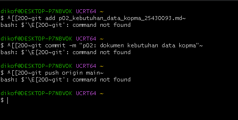  
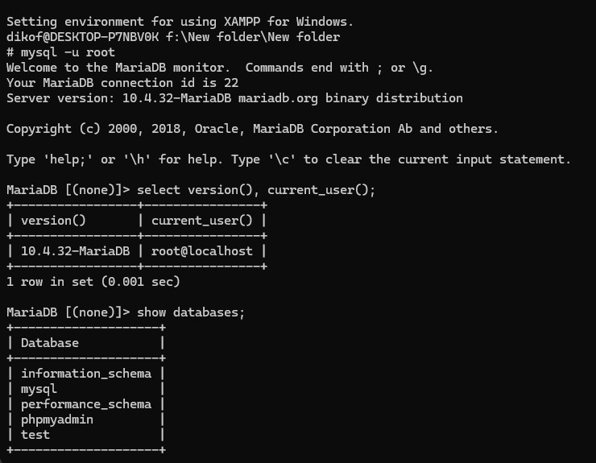  
*Gambar 3.1: Hasil verifikasi versi MariaDB dan konfigurasi mode SQL ketat.*

### 3.2 Pengamanan Kata Sandi Akun Root
Melakukan pembaruan keamanan dengan menetapkan kata sandi baru pada akun administrator utama (`root`).

  
*Gambar 3.2: Pengujian autentikasi login akun root menggunakan kata sandi baru.*

### 3.3 Pembuatan Basis Data dan Akun Operasional Khusus
Membangun basis data praktikum `kopma_093` beserta pembuatan akun operasional mahasiswa `mhs_093` dengan pembatasan hak istimewa secara spesifik.

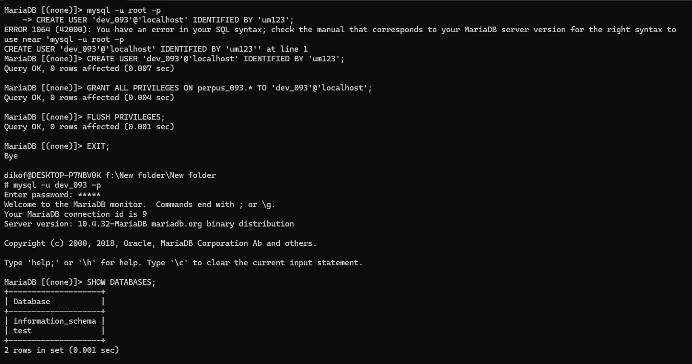  
*Gambar 3.3: Proses pembuatan basis data kopma_093 dan alokasi hak akses akun mhs_093.*

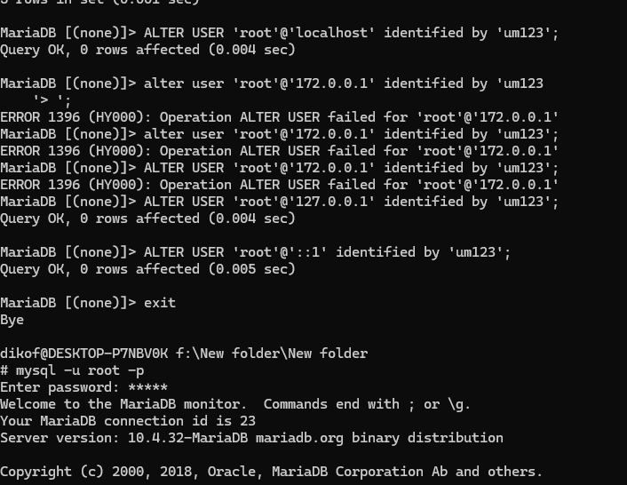  
*Gambar 3.4: Hasil eksekusi perintah SHOW DATABASES pada akun mhs_093.*

### 3.4 Autentikasi Panel phpMyAdmin
Mengakses panel administrasi basis data berbasis web melalui peramban setelah menyesuaikan parameter keamanan autentikasi mode *cookie*.

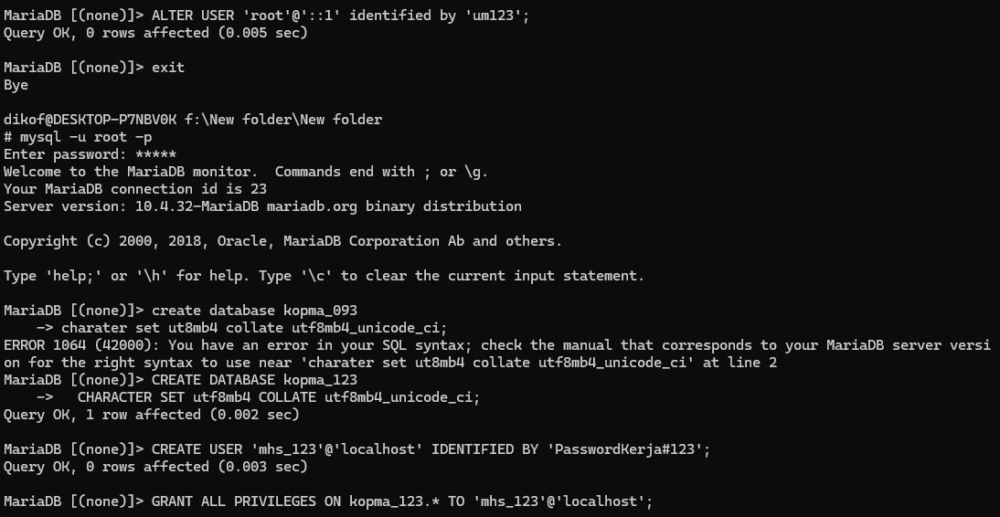  
*Gambar 3.5: Panel halaman login phpMyAdmin.*

### 3.5 Sinkronisasi Repositori Proyek ke GitHub
Menginisialisasi kendali versi Git secara lokal di dalam direktori kerja dan mendorong (*push*) data perubahan pertama ke peladen jarak jauh GitHub.

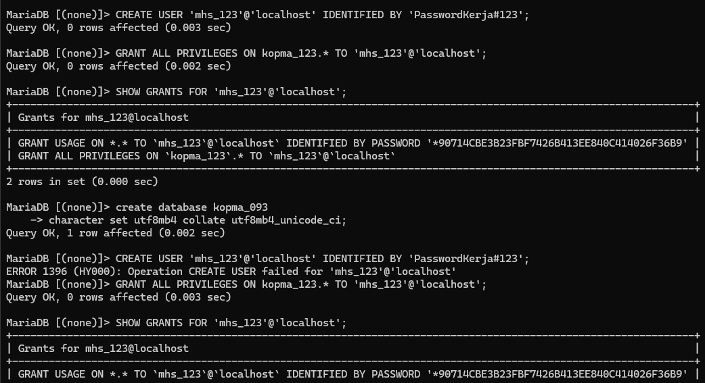  
*Gambar 3.6: Riwayat unggahan arsip modul pertama ke repositori GitHub.*

---

## 3.6 Rekapitulasi Evaluasi Komponen dan Hak Akses Sistem
Tabel berikut menyajikan rekam jejak pengujian hak akses serta status autentikasi yang divalidasi langsung pada lingkungan server MariaDB praktikum:

| No | Identitas Objek / Akun | Target Basis Data | Hak Istimewa (*Privileges*) | Status Pengujian & Respons Sistem |
| :---: | :--- | :--- | :--- | :--- |
| **1** | `'root'@'localhost'` | *Global (All Databases)* | Administrator Penuh (*ALL PRIVILEGES*) | **Berhasil** — Login berhasil menggunakan kata sandi baru. |
| **2** | `'mhs_093'@'localhost'` | `kopma_093` | Kontrol Penuh pada Basis Data Terkait | **Berhasil** — Menampilkan `kopma_093` dan `information_schema`. |
| **3** | `'tamu_093'@'localhost'` | `kopma_093` | Hak Baca Terbatas (*SELECT Only*) | **Ditolak** — Memicu galat `ERROR 1142` saat perintah *DDL*. |
| **4** | `'dev_093'@'localhost'` | `klinik_093` | Pengembang Proyek Mandiri | **Berhasil** — Isolasi pangkalan data proyek mandiri berjalan akurat. |

---

## 4. Jawaban Titik Analisis

### **Titik Analisis 1**
* **Pertanyaan:** Label tombol bertuliskan “MySQL”, tetapi yang berjalan adalah MariaDB. Apa konsekuensinya ketika Anda mencari solusi galat di internet? Kapan dokumentasi MySQL masih relevan, dan kapan Anda harus merujuk ke dokumentasi MariaDB?
* **Jawaban:** Label pada XAMPP tertulis "MySQL", namun perangkat lunak aslinya adalah MariaDB 10.4.32. Dokumentasi MySQL masih sangat relevan untuk standar dasar kueri ANSI SQL. Akan tetapi, ketika menghadapi galat spesifik terkait manajemen penyimpanan internal, variabel konfigurasi mesin, atau optimasi perilaku peladen, rujukan wajib dialihkan ke dokumentasi resmi MariaDB agar solusi yang diterapkan akurat.

### **Titik Analisis 2**
* **Pertanyaan:** Keluar lagi, lalu coba masuk dengan `mysql -u root` tanpa `-p`. Catat pesan galat yang muncul. Bagian mana dari pesan itu yang memberi tahu bahwa klien tidak mengirim password?
* **Jawaban:** Pesan galat yang muncul adalah `ERROR 1045 (28000): Access denied for user 'root'@'localhost' (using password: NO)`. Bagian yang menegaskan bahwa klien tidak mengirimkan kata sandi adalah frasa `(using password: NO)`. Kondisi ini berbeda dengan `using password: YES` di mana kata sandi dikirim namun salah.

### **Titik Analisis 3**
* **Pertanyaan:** Mengapa `information_schema` tetap terlihat oleh akun kerja, sedangkan `mysql` ditolak dengan `ERROR 1044`? Apa bedanya kode galat 1044 dengan 1045?
* **Jawaban:** `information_schema` berisi metadata sistem yang dapat dilihat sesuai hak akses akun, sedangkan akses ke basis data sistem `mysql` ditolak karena akun kerja tidak memiliki izin untuk membukanya. Perbedaan utamanya, `ERROR 1045` menunjukkan kegagalan autentikasi, sedangkan `ERROR 1044` menunjukkan bahwa autentikasi berhasil tetapi akses ke basis data yang diminta tidak diizinkan.

### **Titik Analisis 4**
* **Pertanyaan:** Mode *cookie* meminta pengguna mengetik password setiap kali masuk. Mengapa mode ini lebih aman daripada mode *config* yang menyimpan password di dalam berkas konfigurasi?
* **Jawaban:** Mode *cookie* tidak menyimpan kata sandi basis data di dalam berkas konfigurasi phpMyAdmin, sehingga mengurangi risiko kebocoran kredensial jika berkas konfigurasi terekspos. Namun, mode ini tidak menghilangkan seluruh risiko keamanan; akses tetap perlu dilindungi, misalnya dengan HTTPS dan pengamanan sesi.

---

## 5. Hasil Latihan dan Modifikasi

### 5.1 Pengujian Hak Akses Akun Tamu (`tamu_093`)
Latihan ini menguji pembatasan hak akses di mana akun `tamu_093` hanya diberikan izin pembacaan data (`SELECT`) pada basis data `kopma_093`.

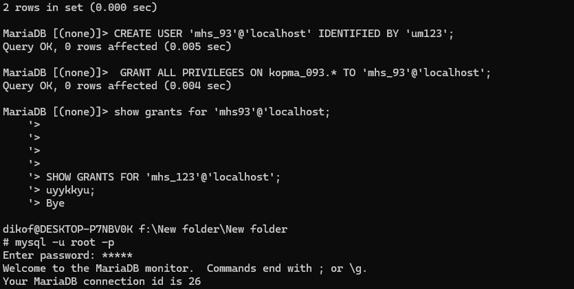  
*Gambar 5.1: Pembuatan akun tamu dengan hak istimewa terbatas.*

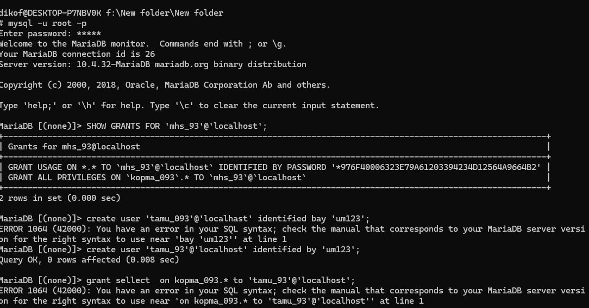  
*Gambar 5.2: Respons galat `ERROR 1142 (42000): CREATE command denied` saat akun tamu mencoba membuat tabel.*

### 5.2 Penyesuaian Skrip Lingkungan Idempotent
Skrip dioptimalkan menggunakan klausa kondisional `IF NOT EXISTS` agar aman dieksekusi secara berulang tanpa memicu galat objek ganda.

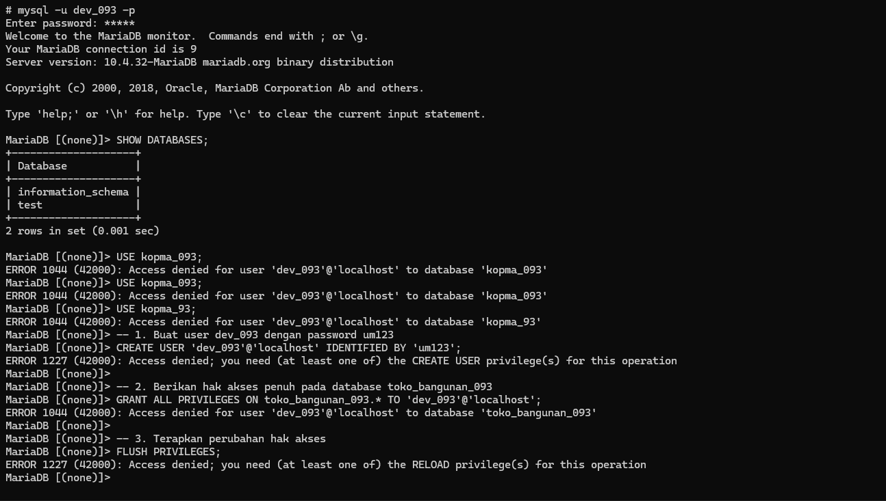  
*Gambar 5.3: Tampilan penyusunan skrip lingkungan idempotent.*

---

## 6. Tugas Mandiri: Milestone Proyek 01 (Tema: Klinik)
Berdasarkan ketentuan dua digit terakhir NIM (`93`), tema proyek mandiri yang dikerjakan pada modul ini adalah **Klinik**.

### 6.1 Inisialisasi Basis Data dan Akun Proyek
Membangun basis data khusus proyek bernama `klinik_093` serta menciptakan akun pengembang terisolasi bernama `dev_093`.

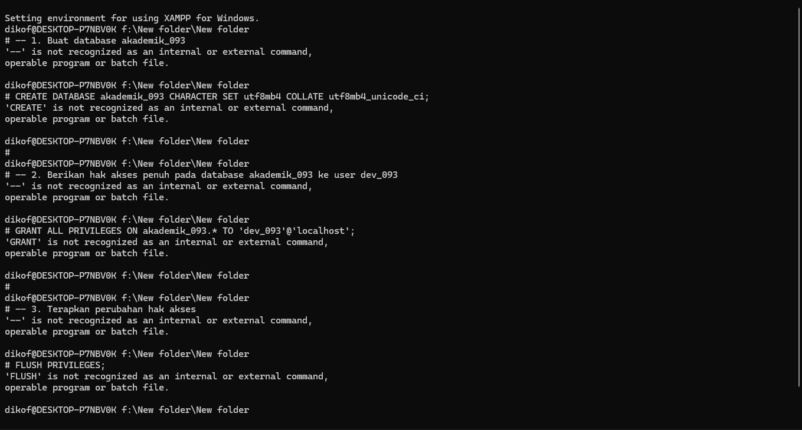  
*Gambar 6.1: Konstruksi basis data klinik_093.*

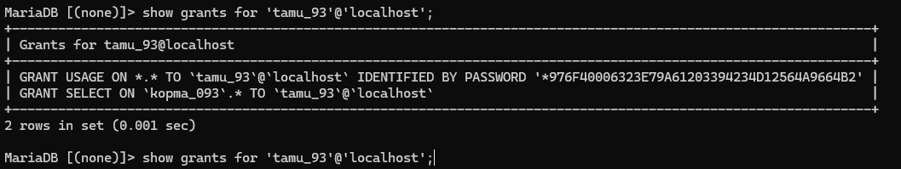  
*Gambar 6.2: Alokasi akun pengembang dev_093.*

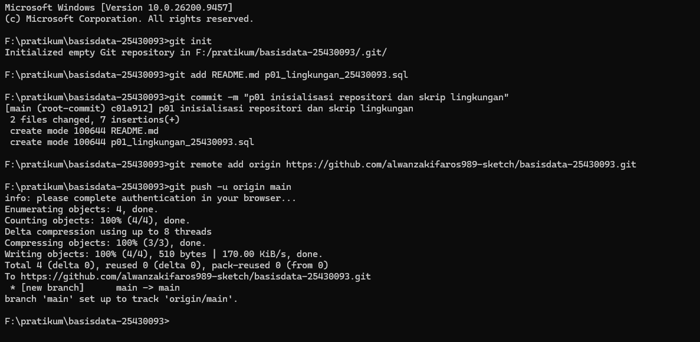  
*Gambar 6.3: Validasi visibilitas pangkalan data pada akun dev_093.*

### 6.2 Pengelolaan Berkas Proyek dan Dokumentasi Repositori
* **Penyusunan Berkas `.gitignore`:** Dibuat untuk menyaring berkas sensitif instans lokal agar tidak ikut terunggah ke peladen publik.
* **Pembaruan Berkas `README.md`:** Menyertakan informasi identitas tema proyek fiktif **"Klinik Utama Sehat Alwan 093"**.

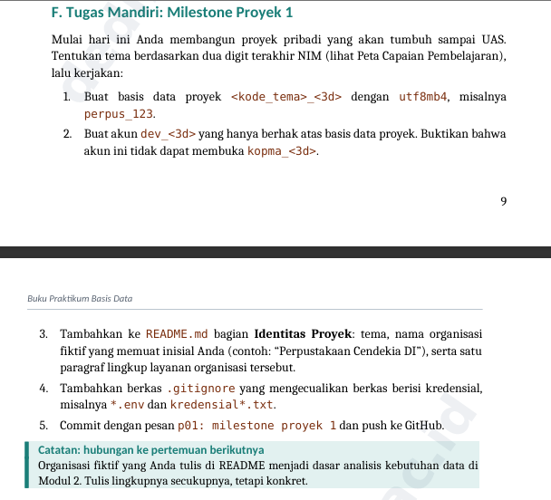  
*Gambar 6.4: Tampilan dokumentasi identitas proyek pada berkas README.md.*

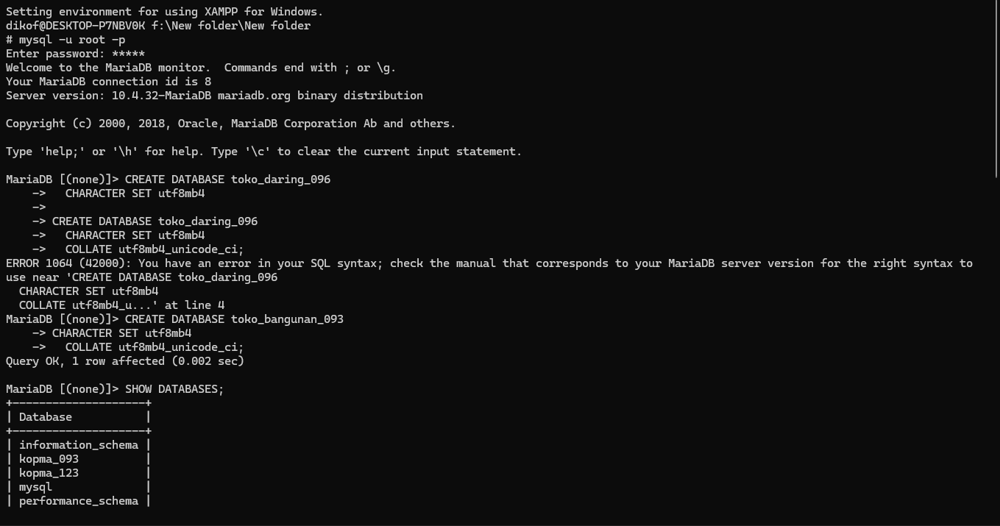  
*Gambar 6.5: Riwayat dorongan data akhir proyek mandiri ke GitHub.*

---

## 7. Pembahasan dan Kendala Teknis

1. **Konflik Porta Layanan (Port Conflict 3306):** Layanan MariaDB sempat gagal aktif karena porta 3306 diduduki oleh proses layanan latar belakang instans MySQL lain. Kendala diatasi dengan menghentikan proses konflik melalui manajer layanan Windows (`services.msc`).
2. **Kesalahan Pengetikan Nama Objek (*Typo*):** Terjadi beberapa kali salah ketik pada penamaan basis data saat memberikan hak istimewa akses. Solusinya dilakukan pemeriksaan ulang menggunakan perintah penelusuran struktur.
3. **Pemahaman Alur Kerja Kendali Versi Git:** Pada tahap awal terdapat kebingungan mengenai fungsi perintah `git add`, `git commit`, dan `git push`. Hal ini diselesaikan dengan memahami bahwa perubahan harus masuk ke *staging area* terlebih dahulu sebelum dicatat dan didorong ke peladen jarak jauh.

---

## 8. Kesimpulan
1. Lingkungan kerja server basis data MariaDB 10.4.32 pada XAMPP berhasil dikonfigurasi dan diverifikasi fungsionalitasnya secara optimal melalui terminal CLI maupun antarmuka web.
2. Protokol keamanan pangkalan data berhasil diterapkan melalui perlindungan kata sandi administrator dan pembatasan hak akses minimum (*least privilege*) bagi akun kerja operasional maupun pengembang proyek.
3. Seluruh rangkaian artefak skrip, dokumentasi, dan riwayat revisi kode telah berhasil diintegrasikan ke dalam kendali versi Git dan repositori GitHub secara terstruktur.

---

## 9. Pernyataan Penggunaan Kecerdasan Buatan (AI)
Pada penyusunan laporan ini, alat kecerdasan buatan yang digunakan adalah Google Gemini. Pemanfaatannya terbatas untuk membantu memahami pesan galat (*error diagnostics*), memeriksa sintaks perintah idempoten, serta merapikan format laporan Markdown. Seluruh proses eksekusi perintah, perancangan basis data, pengujian sistem, dan penyusunan naskah dikerjakan secara mandiri.

Ringkasan prompt yang digunakan: meminta arahan untuk melanjutkan dari persiapan lingkungan pada Modul 1 ke Modul 2, yaitu analisis kebutuhan pengelolaan data sebelum penulisan DDL dan tabel.

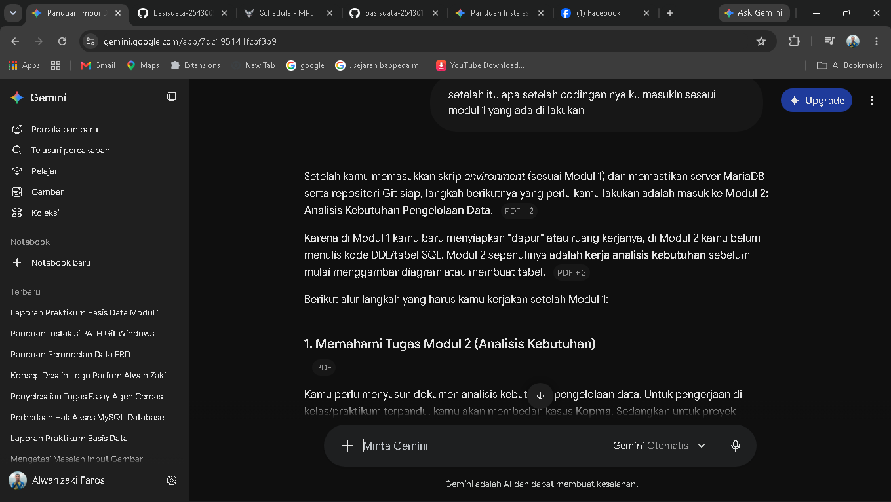  
*Gambar 9.1: Dokumentasi penggunaan alat bantu asistensi digital.*

---

## 10. Bukti Otentisitas dan Kendali Versi Git
* **Repository URL:** `https://github.com/alwanzaki/basisdata-25430093`  
* **Commit Message:** `p01: milestone proyek 1`  
* **Hash Commit:** `ce42998`  

---

## Checklist

### Checklist Umum
| Butir Penilaian | Komponen Pendukung Wajib | Status Pemenuhan |
| :--- | :--- | :---: |
| **Identitas Akademik** | Nama lengkap, NIM, kelas, pertemuan modul, tanggal, nama dosen | ☑ Sesuai |
| **Tujuan Praktikum** | Penjabaran tujuan operasional menggunakan bahasa mandiri | ☑ Sesuai |
| **Ringkasan Teori** | Uraian pemahaman dasar teori ringkas padat maksimal setengah halaman | ☑ Sesuai |
| **Langkah Percobaan** | Bukti visual tangkapan layar langkah kunci beserta keterangan analitis | ☑ Sesuai |
| **Titik Analisis** | Penyelesaian tuntas seluruh butir Titik Analisis disertai argumentasi logis | ☑ Sesuai |
| **Latihan Praktis** | Berkas skrip latihan mandiri dan bukti eksekusi terminal terlampir | ☑ Sesuai |
| **Tugas Mandiri** | Milestone proyek klinik sesuai digit NIM beserta dokumentasi desain | ☑ Sesuai |
| **Kendala & Solusi** | Analisis hambatan teknis yang ditemui beserta metode perbaikannya | ☑ Sesuai |
| **Kesimpulan** | Rangkuman hasil pencapaian praktikum dalam narasi mandiri | ☑ Sesuai |
| **Pernyataan AI** | Transparansi batas penggunaan instrumen kecerdasan buatan | ☑ Sesuai |
| **Bukti Repositori** | Tautan repositori aktif dan kode *hash commit* pertemuan terlampir | ☑ Sesuai |
| **Keaslian Berkas** | Seluruh tangkapan layar menampilkan identitas NIM dan *timestamp* valid | ☑ Sesuai |

### Checklist Khusus Pertemuan 1
| Jenis Bukti Teknis | Kriteria Spesifik Penilaian | Status Pemenuhan |
| :--- | :--- | :---: |
| **Berkas Kode Sumber** | Ketersediaan `p01_lingkungan_25430093.sql`, `README.md`, dan `.gitignore` | ☑ Sesuai |
| **Bukti Visual 1** | Tangkapan layar eksekusi kueri `SELECT VERSION(), CURRENT_USER();` | ☑ Sesuai |
| **Bukti Visual 2** | Tangkapan layar pemeriksaan parameter variabel `SELECT @@sql_mode;` | ☑ Sesuai |
| **Bukti Visual 3** | Tangkapan layar perintah `SHOW DATABASES;` menggunakan akun `mhs_093` | ☑ Sesuai |
| **Bukti Visual 4** | Tangkapan layar perintah `SHOW DATABASES;` menggunakan akun `dev_093` | ☑ Sesuai |
| **Bukti Visual 5** | Tangkapan layar pesan galat autentikasi dan otorisasi (Kode 1044, 1045, 1142) | ☑ Sesuai |
| **Bukti Visual 6** | Tangkapan layar akses panel masuk *phpMyAdmin* berbasis mekanisme *cookie* | ☑ Sesuai |
| **Bukti Visual 7** | Tangkapan layar riwayat keberhasilan dorongan data `git push` ke peladen | ☑ Sesuai |
| **Analisis Akademik 1**| Penjelasan komprehensif atas penyelesaian Titik Analisis nomor 1 sampai 4 | ☑ Sesuai |
| **Analisis Akademik 2**| Uraian taksonomi mendalam perbedaan kode galat 1044, 1045, dan 1142 | ☑ Sesuai |