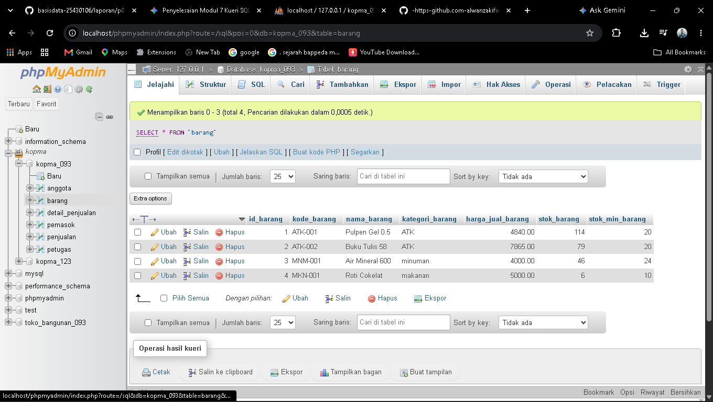
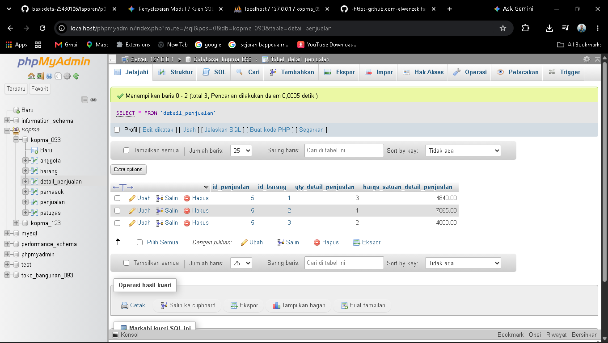

# Laporan Praktikum Basis Data — Pertemuan 7

* **Nama:** Alwan Zaki Faros
* **NIM:** 25430093
* **Kelas:** TIF3D
* **Pertemuan / Topik:** Pertemuan 7 — `SELECT` dan Fungsi Skalar
* **Tanggal Praktikum:** 23 November 2026
* **Basis Data Praktikum & Proyek:** `kopma_093` dan `toko_bangunan_093`

---

## 1. Tujuan Praktikum

Praktikum Pertemuan 7 disusun untuk mencapai sasaran berikut:

1. Mengambil dan memproyeksikan kolom tertentu dari satu tabel menggunakan `SELECT`, alias kolom, dan `DISTINCT`.
2. Menerapkan penyaringan baris memakai operator perbandingan, logika, `IN`, `BETWEEN`, `LIKE`, dan `IS NULL`, serta mengatur urutan dan batas baris lewat `ORDER BY` dan `LIMIT`.
3. Memanfaatkan fungsi skalar teks, tanggal, numerik, serta ekspresi kondisional (`CASE`, `IF`, `IFNULL`) untuk mengolah data per baris.
4. Menyusun kueri satu tabel mandiri yang menjawab Kebutuhan Informasi (KI) proyek Toko Bangunan (`toko_bangunan_093`) beserta catatan keterbatasannya.

---

## 2. Ringkasan Dasar Teori

Pernyataan `SELECT` berfungsi membaca baris dari satu tabel (`FROM`) lalu menyaringnya (`WHERE`), memilih kolom atau ekspresi (`SELECT`), menyusun urutan tampil (`ORDER BY`), dan membatasi jumlah baris keluaran (`LIMIT`). Secara logis, mesin SQL memproses `FROM` dan `WHERE` sebelum `SELECT`, kemudian `ORDER BY` dan `LIMIT`. Karena `WHERE` berjalan mendahului `SELECT`, alias kolom hasil proyeksi belum dikenal pada `WHERE`.

Fungsi skalar bekerja secara individual untuk setiap baris (*row-by-row*), berbeda dengan fungsi agregat yang merangkum banyak baris menjadi satu nilai. Selain ketepatan sintaks, ketepatan logika atau semantik kueri juga menentukan kebenaran hasil—misalnya penempatan tanda kurung saat menggabungkan `AND` dan `OR`, serta penggunaan `IS NULL` untuk nilai kosong yang tidak diketahui.

---

## 3. Hasil Langkah Percobaan

Percobaan dijalankan pada basis data `kopma_093` dan dicatat dalam berkas `p07_kueri_kopma_25430093.sql`.

### 3.1 Proyeksi dan Penyaringan (`D.1`)

* **Stok di bawah batas minimum (`KI-03`):** Memilih `kode_barang`, `nama_barang`, `stok_barang`, `stok_min_barang`, dan selisih `stok_min_barang - stok_barang AS defisit_stok` pada tabel `barang` dengan kondisi `stok_barang < stok_min_barang` dan urutan menurun berdasarkan selisih kekurangan.
* **Penyaringan kategori (`IN`):** Menyaring `barang` dengan `kategori_barang IN ('ATK', 'minuman')` agar hanya kategori terpilih yang muncul.
* **Penyaringan rentang waktu (`BETWEEN`):** Menyaring `penjualan` berdasarkan `tgl_penjualan` pada rentang September 2026.
* **Data kontak kosong (`IS NULL`):** Menyaring `anggota` yang kolom `no_hp_anggota`-nya bernilai `NULL`.



### 3.2 Pola Teks, Nilai Kosong, Tanggal, dan Perhitungan Baris (`D.2` & `D.3`)

* **Format profil anggota & diskon (`D.2`):** Mencari anggota dengan `nama_anggota LIKE '%a%'`, menggabungkan nama dan nomor anggota lewat `CONCAT`, memformat tanggal daftar dengan `DATE_FORMAT(tgl_daftar_anggota, '%d-%m-%Y')`, mengganti `NULL` nomor HP menjadi `'-'` lewat `IFNULL`, menentukan keterangan lewat `CASE`, mengurutkan terbaru, lalu membatasi maksimal 5 baris (`LIMIT 5`).
* **Lama keanggotaan & kategori (`D.3`):** Menghitung selisih hari menggunakan `DATEDIFF(CURDATE(), tgl_daftar_anggota)` dan mengklasifikasikan keanggotaan kurang dari 180 hari sebagai `'baru'` dan lainnya `'lama'`.
* **Subtotal detail transaksi (`D.3`):** Menghitung `(qty_detail_penjualan * harga_satuan_detail_penjualan) AS subtotal_baris` per item pada `detail_penjualan` untuk nota yang ditargetkan.



---

## 4. Jawaban Titik Analisis

### Titik Analisis 1 — Alias pada `WHERE` vs `ORDER BY`
Mengganti `ORDER BY kurang` menjadi `WHERE kurang > 0` memicu galat karena `WHERE` dievaluasi sebelum `SELECT`, sehingga alias `kurang` belum terbentuk saat kondisi `WHERE` diperiksa. Sebaliknya, `ORDER BY` diproses setelah `SELECT` sehingga alias sudah dikenali.

Bentuk syarat setara tanpa memakai alias di `WHERE`:
```sql
SELECT kode_barang,
       nama_barang,
       stok_barang,
       stok_min_barang,
       (stok_min_barang - stok_barang) AS kurang
FROM barang
WHERE (stok_min_barang - stok_barang) > 0
ORDER BY kurang DESC;
```

### Titik Analisis 2 — `NULL` vs String Kosong (`''`)
`WHERE no_hp_anggota = NULL` tidak menghasilkan baris karena `NULL` menyatakan ketiadaan nilai/nilai tidak diketahui, sehingga perbandingan `= NULL` bernilai `UNKNOWN` dan tidak diloloskan `WHERE`. Pemeriksaan yang tepat memakai `WHERE no_hp_anggota IS NULL`.

* **`NULL`:** Menandakan nilai belum ada atau tidak diketahui; dicek dengan `IS NULL` / `IS NOT NULL`.
* **String kosong (`''`):** Merupakan nilai teks valid dengan panjang 0 karakter; dicek dengan `= ''`.

### Titik Analisis 3 — Subtotal per Baris vs Total Nota
Perhitungan `qty * harga_satuan` pada Modul 7 menghasilkan nilai untuk tiap baris detail secara terpisah. Menghitung total keseluruhan satu nota memerlukan penggabungan beberapa baris menjadi satu nilai ringkasan memakai **fungsi agregat `SUM()`** dan pengelompokan **`GROUP BY`** (dipelajari di Pertemuan 9).

---

## 5. Hasil Latihan dan Modifikasi (`E`)

1. **Huruf kapital & format Rupiah (`E.1`):** Menggunakan `UPPER(nama_barang)` untuk huruf besar dan `CONCAT('Rp', FORMAT(harga_jual_barang, 0, 'id_ID'))` untuk format nominal Rupiah.
2. **Kesalahan semantik `OR` tanpa tanda kurung (`E.2`):** Karena `AND` diprioritaskan lebih tinggi daripada `OR`, syarat tanpa tanda kurung dapat meloloskan baris yang tidak sesuai maksud. Mengapit kondisi `OR` dengan tanda kurung `(...)` memperjelas urutan logika penyaringan.


---

## 6. Tugas Mandiri: Milestone Proyek 7 (`p07_kueri_25430093.sql`)

Berkas `p07_kueri_25430093.sql` memuat 10 kueri satu tabel pada basis data proyek `toko_bangunan_093`. Setiap kueri dilengkapi komentar kode KI, pertanyaan sehari-hari, serta hasil yang diharapkan sebelum dijalankan.

### 6.1 Pemetaan Kueri ke Kebutuhan Informasi (KI) dan Fungsi Skalar

| No. | Kode KI | Tujuan Kueri Satu Tabel | Operator / Fungsi Skalar | Alasan Pemilihan |
|---|---|---|---|---|
| 1 | KI-01 | Material di bawah stok minimum | `<`, pengurangan | Mengetahui unit kekurangan untuk rencana restock |
| 2 | KI-01 | Klasifikasi stok & nama kapital | `CASE`, `UPPER` | Memberi label status stok dan menyeragamkan nama barang |
| 3 | KI-02 | Pencarian nama barang (`semen`/`cat`) | `LIKE` | Mencocokkan potongan kata pada nama material |
| 4 | KI-02 | Filter kategori & format harga | `IN`, `CONCAT`, `FORMAT` | Memilih beberapa kategori sekaligus dan memformat Rupiah |
| 5 | KI-03 | Pelanggan tanpa nomor HP | `IS NULL`, `IFNULL` | Menjaring data kontak kosong dan menampilkan tanda `-` |
| 6 | KI-03 | Lama terdaftar pelanggan | `CONCAT`, `DATE_FORMAT`, `DATEDIFF`, `CURDATE` | Menggabungkan identitas, memformat tanggal, dan menghitung hari |
| 7 | KI-04 | Penjualan pada rentang tanggal | `BETWEEN` | Menyaring transaksi pada periode tanggal tertentu |
| 8 | KI-04 | Penjualan pembeli non-member | `IS NULL`, `LIMIT` | Mengambil nota transaksi tanpa `id_pelanggan` terbaru |
| 9 | KI-05 | Subtotal per item pada nota | Perkalian per baris | Menghitung nilai tiap baris detail penjualan |
| 10 | KI-05 | Pemasok berdasarkan wilayah | `LIKE`, `UPPER` | Menyaring alamat pemasok berdasarkan pola wilayah |

### 6.2 Keterbatasan Kueri Satu Tabel (Pertemuan 9–12)
* Rekapitulasi total pendapatan, jumlah transaksi per periode, atau rata-rata nilai nota membutuhkan fungsi agregat (`SUM`, `COUNT`, `AVG`) dan `GROUP BY` (Pertemuan 9).
* Penyajian informasi lintas entitas—seperti nama barang pada rincian transaksi, nama kasir, atau nama pemasok per item—memerlukan `JOIN` (Pertemuan 10).
* Pencarian entitas yang tidak memiliki pasangan transaksi atau perbandingan himpunan data memerlukan `SUBQUERY` / operasi himpunan (Pertemuan 11).
* Analisis peringkat dan akumulasi berjalan memerlukan `CTE` dan *window function* (Pertemuan 12).


---

## 7. Pembahasan dan Kendala

| Kendala yang Ditemui | Penyebab | Langkah Penyelesaian |
|---|---|---|
| Galat saat menjalankan `USE kopma_93;` di tab SQL phpMyAdmin | Basis data aktif sudah terpilih di sesi atau nama basis data berbeda dari yang ditulis | Menjalankan kueri langsung pada basis data aktif dan menyelaraskan nama basis data (`kopma_093` / `toko_bangunan_093`) |
| Galat tabel tidak ditemukan saat menguji kueri proyek | Kueri proyek dijalankan ketika konteks aktif masih berada pada basis data lain | Mengarahkan eksekusi ke basis data proyek `toko_bangunan_093` sesuai struktur DDL |

---

## 8. Kesimpulan

Kueri satu tabel dengan `SELECT` dan fungsi skalar efektif untuk menyaring, mengurutkan, memformat, serta mengklasifikasikan data per baris sesuai kebutuhan informasi. Ketelitian pada urutan evaluasi klausa, logika `NULL`, dan prioritas operator logika mencegah kesalahan hasil kueri. Kebutuhan agregasi kelompok, relasi antartabel, dan analisis lanjutan disiapkan untuk modul berikutnya.

---

## 9. Pernyataan Penggunaan AI

Asisten AI dimanfaatkan sebagai pendamping belajar untuk membantu menyusun struktur laporan, menjelaskan konsep urutan evaluasi SQL dan perbedaan `NULL` dengan string kosong, serta menyusun variasi draf komentar dan kueri satu tabel pada berkas `.sql`. Seluruh kueri telah disesuaikan dengan skema basis data dan diuji secara langsung.

---

## 10. Bukti Git

* **Repositori:** `https://github.com/alwanzaki/basisdata-25430093`
* **Berkas terkait:** `p07_kueri_kopma_25430093.sql`, `p07_kueri_25430093.sql`, `laporan/p07_laporan_25430093.md`
* **Hash Commit:** `<isi_dengan_hash_commit_p07>` *(pesan: `p07: kueri kopma, milestone proyek, dan laporan`)*

---

## 11. Checklist

* [x] Identitas lengkap tercantum
* [x] Tujuan dan ringkasan teori disusun dengan bahasa sendiri
* [x] Langkah percobaan (`D`) beserta bukti tangkapan layar tersedia
* [x] Jawaban Titik Analisis 1–3 lengkap beserta contoh kueri
* [x] Latihan dan modifikasi (`E`) beserta hasil/perbaikan disertakan
* [x] Tugas mandiri (`F`) `p07_kueri_25430093.sql` berisi 10 kueri satu tabel dengan komentar KI dan hasil yang diharapkan, serta pemetaan KI dan alasan fungsi skalar
* [x] Pembahasan kendala, kesimpulan, pernyataan penggunaan AI, dan bukti Git tersedia